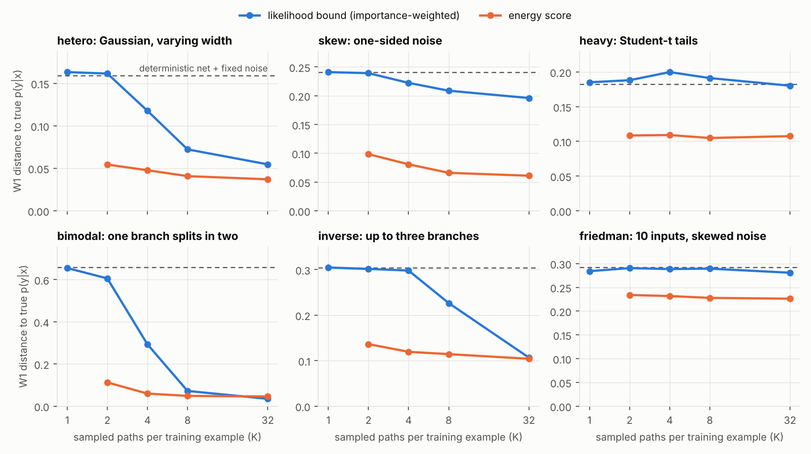
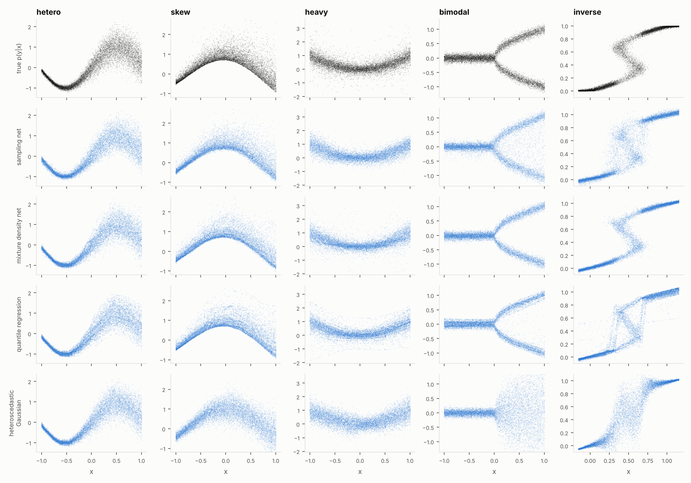
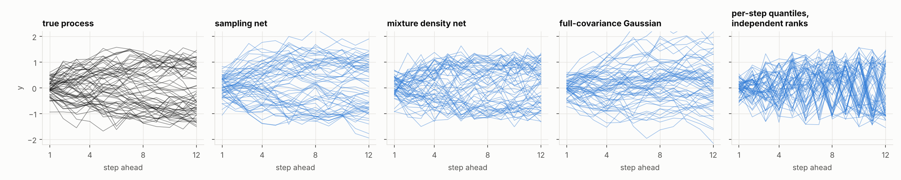
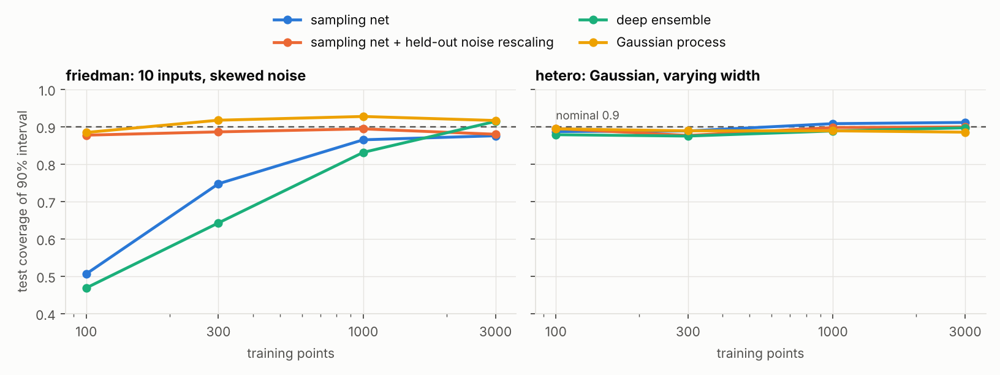
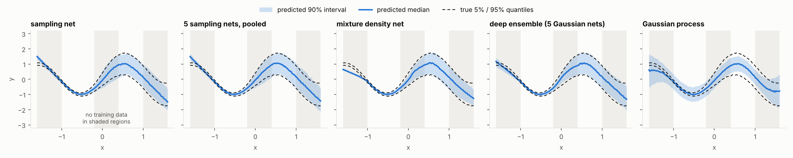

# gpnn

A neural network that returns a predictive distribution, and therefore
intervals, without a posterior over weights or functions.

The starting hypothesis was: Gaussian-process methods spend their effort on
epistemic uncertainty, which is hopeless for hard problems; instead, treat the
network graph as a probabilistic relationship, of which ordinary gradient
descent is a one-sample Monte Carlo estimate. This repository tests that
hypothesis and keeps what survived.

## What survived

1. **One sample is a deterministic network.** Under the likelihood and under
   the energy score alike, training with one sampled path per example ignores
   the injected noise and recovers plain regression. The "1-sample MC" reading
   is correct, and one sample is the degenerate case.
2. **Two samples and a proper scoring rule are enough.** Draw two noisy forward
   passes, pull each towards the target, push them apart from each other. That
   is an unbiased estimate of a strictly proper score (the energy score, CRPS
   for scalar targets), and it already learns skewed, heavy-tailed and
   multimodal conditionals. The likelihood route needs 8 to 32 samples to
   leave the deterministic regime and on some problems never does.
3. **The noise does not need to live in the nodes.** Noise appended to the
   input does as well as noise at every hidden node, or better, at half the
   cost. What matters is that the network is a sampler, not which nodes are
   stochastic. Analytic propagation of moments through the nodes, the place
   where GP machinery would re-enter, only helps when the truth is Gaussian.
4. **On scalar regression it ties the best existing aleatoric methods.** On
   synthetic problems with a known truth it matches mixture density networks
   and quantile regression with 2000 points, is ahead of both on four of six
   problems with 200, and beats Gaussian heads, deep ensembles, MC dropout and
   a GP whenever the noise is not Gaussian. On nine UCI sets it is level with
   quantile regression and ahead of the rest on average. It costs about four
   times as much to train as a mixture density network.
5. **On vector targets it is the best method tested.** Because it samples whole
   vectors, intervals for sums, maxima or ranges of the outputs come for free
   and are close to calibrated; per-output quantile heads cover a nominal 90%
   interval about half the time.
6. **Dropping epistemic uncertainty has a measurable price.** With 100 points
   in 10 dimensions the nominal 90% interval covers 51% of test points (a GP:
   88%), on the small UCI sets it covers as little as 62%, and the model gives
   no warning when it extrapolates. Rescaling the noise on held-out data
   repairs the first two (88%, and 83% at worst on UCI) and not the third. The
   intervals are native; on small data they are trustworthy only after that
   held-out correction.

The rest of this file is the evidence, in the order the questions arose.
Everything is reproducible on a 4-core CPU.

## Use

```python
from gpnn.api import ProbNet

net = ProbNet().fit(x, y)                      # y: (N,) or (N, D)
lo, hi = net.interval(x_new, level=0.9)        # central interval
parts  = net.regions(x_new, level=0.9)         # union of intervals if multimodal
draws  = net.sample(x_new, n=1000)             # (N, 1000) or (N, 1000, D)
q      = net.quantile(x_new, [0.05, 0.5, 0.95])

# vector y: an interval for any function of the outputs
lo, hi = net.interval(x_new, 0.9, fn=lambda y: y.sum(-1))
```

`ProbNet` is a ReLU MLP that takes `[x, eps]` with `eps ~ N(0, I_8)` and is
trained on the energy score with `K=8` sampled outputs per example. After
training it rescales its noise on a held-out split (finding 6; scalar targets
only). Everything it
reports is read off its samples.

## The model and the two ways to train it

A network with noise in it defines a conditional distribution: `y = g(x, eps)`
with `eps` drawn fresh for every input. Its likelihood marginalises the noise,
`p(y|x) = E_eps[ p(y | g(x, eps)) ]`, and there are two ways to turn K sampled
forward passes `y_1..y_K` into a training signal.

**Likelihood.** Put the Monte Carlo average inside the log:
`log (1/K) sum_k p(y | y_k)`, where `p(y | y_k)` is a Gaussian output noise
around the k-th sampled output. By Jensen this is a lower bound that is tight
only as K grows. At K=1 it is `E[log p(y | y_1)]`: regression with noise
injected, whose optimum is to make the noise irrelevant.

**Energy score.**
`(1/K) sum_k |y - y_k|  -  1/(2K(K-1)) sum_{k != k'} |y_k - y_k'|`.
Its expectation is the CRPS of the model's predictive distribution for every
K >= 2, and the CRPS is minimised only by the true conditional. The objective
is linear in the predictive distribution, so the Monte Carlo estimate is
unbiased and K controls gradient noise only. At K=1 the second term vanishes
and what is left is median regression.

So ordinary gradient descent is the K=1 case of both, and K=1 is degenerate
for both. They differ in how many samples it takes to leave it.

## 1. How many samples, scored how

Six synthetic problems where the true `p(y|x)` can be sampled, so a model is
judged by the Wasserstein-1 distance between its conditional and the true one
(averaged over test inputs, in units of the standard deviation of y), not only
by held-out points. 2000 training points, 3 seeds. All hidden nodes noisy.



| objective, K | hetero | skew | heavy | bimodal | inverse | friedman |
|---|---:|---:|---:|---:|---:|---:|
| deterministic net + fixed noise | 0.159 | 0.240 | 0.182 | 0.657 | 0.303 | 0.292 |
| likelihood, K=1 | 0.163 | 0.241 | 0.185 | 0.655 | 0.305 | 0.284 |
| likelihood, K=2 | 0.161 | 0.239 | 0.188 | 0.605 | 0.302 | 0.290 |
| likelihood, K=8 | 0.072 | 0.209 | 0.191 | 0.072 | 0.226 | 0.289 |
| likelihood, K=32 | 0.055 | 0.196 | 0.180 | **0.035** | 0.107 | 0.281 |
| energy score, K=2 | 0.054 | 0.098 | 0.108 | 0.112 | 0.136 | 0.234 |
| energy score, K=8 | 0.041 | 0.066 | **0.105** | 0.049 | 0.114 | 0.228 |
| energy score, K=32 | **0.037** | **0.061** | 0.108 | 0.046 | **0.104** | **0.226** |

- Likelihood training with K=1 or 2 is indistinguishable from the
  deterministic network on all six problems. The model learns an output noise
  of 0.65 standard deviations and routes nothing through its stochastic nodes;
  energy-score training learns 0.10 and lets the sampled paths carry the
  distribution.
- On `skew`, `heavy` and `friedman` the likelihood barely moves from that
  solution even at K=32. The bound is too loose for the gradient to find a use for the
  noise.
- The energy score leaves it at K=2 everywhere and is close to saturated at
  K=8. Integrating the output noise analytically (`es_rb` in the code) helps a
  little at K=2 and not at all beyond.
- Two other objectives were tried and dropped: a quadratic score (also
  unbiased at K=2, but its gradient vanishes when no sample is near the target;
  W1 0.48 on `bimodal`), and likelihood plus energy score (behaves like the
  likelihood alone).

Result file: `results/01_objectives.jsonl`. Script: `experiments/01_objectives.py`.

## 2. Where the randomness should live

Energy score, K=8, same six problems. Rows vary which parts of the graph are
stochastic.

| structure | hetero | skew | heavy | bimodal | inverse | friedman |
|---|---:|---:|---:|---:|---:|---:|
| noise appended to input, ReLU | 0.032 | **0.050** | **0.087** | 0.062 | 0.091 | **0.174** |
| noise appended to input, tanh | 0.038 | 0.052 | 0.117 | **0.053** | 0.107 | 0.188 |
| every hidden node, tanh | 0.044 | 0.065 | 0.113 | 0.058 | 0.116 | 0.227 |
| first hidden layer only | 0.043 | 0.059 | 0.105 | 0.057 | 0.117 | 0.236 |
| last hidden layer only | 0.039 | 0.076 | 0.119 | 0.222 | 0.132 | 0.248 |
| input and every node | 0.055 | 0.061 | 0.104 | 0.059 | 0.115 | 0.184 |
| every node, ReLU | 0.042 | 0.057 | 0.103 | 0.126 | 0.207 | 0.201 |
| every node + last layer integrated analytically | 0.043 | 0.056 | 0.104 | 0.058 | 0.113 | 0.229 |
| every node + per-path variance head | 0.037 | 0.076 | 0.096 | 0.313 | 0.117 | 0.202 |
| every node + parent-dependent noise scale | 0.044 | 0.131 | 0.111 | 0.315 | 0.113 | 0.201 |
| no sampling: moments propagated analytically | **0.027** | 0.188 | 0.201 | 0.282 | 0.231 | 0.218 |

- **Input noise is as good as node noise or better on every problem**, and
  trains in half the time (11 s against 24 s per run) because it draws 8
  random numbers per path instead of 128. Any stochastic layer followed by
  enough deterministic nonlinearity does the job; noise in the last layer
  only, with nothing after it to reshape it, cannot produce two modes.
- **A variance head is a shortcut, and a risky one.** Letting each path widen
  its own output Gaussian helps a little on unimodal problems (`friedman`
  0.202 against 0.227 with node noise). But a tanh network then explains a
  bimodal target with one wide mode and never learns to use its noise (W1 0.31
  against 0.06, with node noise and with input noise alike), and the same
  happens when a node's noise scale depends on its parents. With ReLU and
  input noise the head does no damage (`bimodal` 0.070 against 0.062) and
  buys little (`friedman` 0.161 against 0.174). Constant noise that can only
  be shaped by pushing it through the network is the safer default.
- **How many noise dimensions** (ReLU, input noise): one dimension gives the
  sharpest modes (`inverse` 0.068) and the worst fit in ten dimensions
  (`friedman` 0.219); 32 dimensions reverse that (0.118 and 0.145). Eight is
  the compromise used everywhere else.
- **Analytic propagation** (push a mean and a variance through every layer, no
  sampling, one pass) is the best model when the truth is Gaussian and among
  the worst otherwise. It is a heteroscedastic Gaussian network by another
  route. This is where GP-style machinery would re-enter, and it does not earn
  its place.
- With node noise, tanh matters: its saturation turns Gaussian noise into an
  almost binary variable, which is what a mode needs. With input noise ReLU is
  better, and unbounded activations are what let the sampler stretch Gaussian
  noise into heavy tails (coverage of the 90% interval on `heavy`: 0.86 with
  tanh node noise, 0.89 with ReLU input noise).

This is the main negative result for the original idea. Attaching the
probabilistic semantics to every node buys nothing here; attaching it to the
network as a whole is what works. The likelihood needs each node's conditional
density, which is why it invites node-level modelling. A scoring rule needs
only samples, and that frees the architecture.

Result file: `results/02_structure.jsonl`. Script: `experiments/02_structure.py`.

## 3. Against the usual ways of getting intervals (scalar y)

From here on "sampling net" means the configuration that won above: input
noise, ReLU, energy score, K=8. Every network has the same 2x64 architecture,
optimiser, step budget and early stopping on a validation split. 5 seeds.

W1 distance to the true conditional, 2000 training points:

| | hetero | skew | bimodal | heavy | inverse | friedman |
|---|---:|---:|---:|---:|---:|---:|
| sampling net | 0.031 | 0.052 | 0.062 | 0.087 | 0.094 | 0.165 |
| sampling net, K=2 | 0.038 | 0.053 | 0.075 | 0.100 | 0.126 | **0.157** |
| sampling net, node noise | 0.041 | 0.056 | 0.149 | 0.101 | 0.205 | 0.197 |
| mixture density net (5 Gaussians) | 0.038 | 0.052 | 0.057 | 0.093 | **0.058** | 0.214 |
| quantile regression (100 levels) | 0.035 | **0.047** | **0.042** | **0.078** | 0.080 | 0.183 |
| heteroscedastic Gaussian | 0.033 | 0.178 | 0.285 | 0.164 | 0.230 | 0.233 |
| deep ensemble (5 Gaussian nets) | **0.030** | 0.170 | 0.282 | 0.182 | 0.227 | 0.204 |
| MC dropout | 0.165 | 0.230 | 0.658 | 0.193 | 0.306 | 0.264 |
| dropout net, energy score K=8 | 0.043 | 0.107 | 0.257 | 0.108 | 0.194 | 0.241 |
| deterministic net + fixed noise | 0.162 | 0.218 | 0.656 | 0.184 | 0.303 | 0.272 |
| deterministic net + held-out residuals | 0.164 | 0.144 | 0.665 | 0.119 | 0.297 | 0.277 |
| GP (ARD RBF, 1000 points) | 0.160 | 0.239 | 0.659 | 0.203 | 0.301 | 0.216 |

The same with 200 training points:

| | hetero | skew | bimodal | heavy | inverse | friedman |
|---|---:|---:|---:|---:|---:|---:|
| sampling net | 0.077 | **0.088** | 0.093 | 0.151 | 0.153 | 0.384 |
| sampling net, K=2 | **0.075** | 0.092 | 0.100 | **0.147** | 0.161 | 0.355 |
| mixture density net | 0.101 | 0.115 | 0.100 | 0.186 | **0.147** | 0.400 |
| quantile regression | 0.091 | 0.113 | **0.084** | 0.178 | 0.173 | 0.404 |
| heteroscedastic Gaussian | 0.094 | 0.193 | 0.299 | 0.218 | 0.261 | 0.415 |
| deep ensemble | 0.081 | 0.189 | 0.294 | 0.208 | 0.259 | 0.348 |
| GP | 0.174 | 0.225 | 0.659 | 0.234 | 0.317 | **0.256** |



- Three methods recover non-Gaussian conditionals: the sampling net, the
  mixture density net and quantile regression. With 2000 points they are
  within noise of each other. Quantile regression is slightly ahead on the
  one-dimensional problems, the mixture density net on the sharpest
  multimodal one, the sampling net on the ten-dimensional one.
- With 200 points the sampling net is ahead of both on four of six problems.
- Anything with a Gaussian output (heteroscedastic head, deep ensemble, GP) is
  two to five times further from the truth whenever the noise is skewed,
  heavy-tailed or multimodal. A deep ensemble of Gaussians buys nothing over a
  single one there: its extra spread models the wrong kind of uncertainty.
  This is the part of the original intuition the data supports most directly.
- Two sampled paths per example are nearly as good as eight.
- MC dropout has stochastic nodes and is trained with one sample per step on
  the likelihood, so it is the K=1 case of section 1 in a familiar form. It
  lands on the deterministic network to within 0.01 on five of six problems.
  The same dropout network trained on the energy score with K=8 does learn
  the conditional, less well than with Gaussian input noise.
- The sampling net takes 11 to 15 s to train here, a mixture density net 3 to
  4 s, quantile regression 2 to 3 s.
- Its density estimate is poor in the tails. It is trained on the CRPS, and its
  log-likelihood on `heavy` is 0.84 nats against 0.31 for the mixture density
  net. If you need densities, not intervals, use a mixture density net.

**Intervals for multimodal predictions.** A central interval has to span the
empty space between two modes. `ProbNet.regions` returns the highest-density
region instead, as a union of intervals. On `bimodal` this cuts the length
reported at the 90% level from 0.88 to 0.56 for the sampling net, and from
0.85 to 0.40 for the mixture density net; on `inverse` from 0.56 to 0.50 and
from 0.53 to 0.31. The sampling net's modes are blurrier than a mixture's,
which the figure above also shows, and its regions over-cover (0.94 and 0.96
against a nominal 0.90). `results/08_regions.jsonl`.

Result files: `results/03_baselines_n{2000,200}_{relu,tanh}.jsonl` (the tanh
runs lead to the same conclusions). Script: `experiments/03_baselines.py`.

## 4. Vector targets and intervals for functions of them

`well`: predict the next 12 observations of a double-well diffusion from its
start point and noise level. Paths starting near the unstable equilibrium
commit to one of two wells, so the joint law is bimodal with strong temporal
correlation. 4000 training paths, 3 seeds.



| | energy score | W1: sum | W1: max | W1: range | cover: sum | cover: max | cover: range |
|---|---:|---:|---:|---:|---:|---:|---:|
| sampling net | **1.214** | **0.568** | 0.072 | **0.079** | 0.924 | 0.938 | 0.933 |
| sampling net, node noise | 1.227 | 1.254 | 0.116 | 0.087 | 0.918 | 0.933 | 0.936 |
| sampling net, likelihood K=32 | 1.284 | 2.064 | 0.206 | 0.231 | 0.899 | 0.897 | 0.712 |
| mixture density net (10 diagonal Gaussians) | 1.228 | 0.752 | **0.071** | 0.099 | 0.862 | 0.900 | 0.877 |
| full-covariance Gaussian | 1.260 | 1.870 | 0.149 | 0.082 | 0.898 | 0.924 | 0.886 |
| per-step quantiles, independent ranks | 1.284 | 2.806 | 0.363 | 0.711 | 0.438 | 0.549 | 0.477 |
| per-step quantiles, one shared rank | 1.259 | 1.236 | 0.307 | 0.600 | 0.962 | 0.834 | 0.361 |

The W1 columns compare the predicted and true distributions of the sum,
maximum and range of the 12 outputs; the cover columns give the coverage of
the nominal 90% interval for each.

- A sampler gives the joint distribution, so an interval for any function of
  the outputs is a quantile of that function over the samples. The sampling
  net has the best joint score, is best or tied on the distribution of all
  three functionals, and stays within four points of nominal coverage.
- The full-covariance Gaussian is as well calibrated on coverage, with the
  wrong shape: one mode where the truth has two, and a distribution of the
  sum three times further from the truth.
- The mixture density net's samples are jagged: diagonal components carry no
  correlation between steps. It matches the sampling net on the maximum and is
  worse on the sum and the range.
- Per-output quantile regression has the best marginals and no joint. Under
  either assumed coupling its intervals for these functionals are far off.
- Likelihood training fails here for the reason given in section 5.

**Does the advantage grow with the dimension of y?** The same process over
longer horizons (first D of 48 steps):

| | D=4 | D=12 | D=24 | D=48 |
|---|---:|---:|---:|---:|
| W1 of the range: sampling net | 0.031 | **0.079** | **0.105** | **0.159** |
| W1 of the range: mixture density net | 0.045 | 0.099 | 0.178 | 0.309 |
| W1 of the range: full-covariance Gaussian | **0.027** | 0.082 | 0.230 | 0.297 |
| coverage of the range: sampling net | 0.911 | 0.920 | 0.937 | 0.966 |
| coverage of the range: mixture density net | 0.886 | 0.868 | 0.856 | 0.858 |
| coverage of the range: full-covariance Gaussian | 0.889 | 0.889 | 0.824 | 0.703 |

The mixture density net's error on this path-dependent quantity is 1.5 times
the sampling net's at D=4 and 1.9 times at D=48. The sampling net is not flawless
there: its intervals drift towards over-coverage (0.97 for a nominal 0.90).
The joint energy score itself hardly separates the two methods (3.116
against 3.123 at D=48), which is a known weakness of that score in high
dimension and a reason not to rely on it alone for model comparison.
`results/05b_dimension.jsonl`.

On a two-dimensional problem (`ring`: points on a noisy circle) the mixture
density net is the more accurate (marginal W1 0.059 against 0.088), so the
advantage is specific to higher-dimensional, correlated targets.

Result file: `results/05_multi.jsonl`. Scripts: `experiments/05_multi.py`,
`experiments/05b_dimension.py`.

## 5. A correction: when importance weighting over paths breaks down

In my first reply I said that sampling paths from the prior and weighting them
by the likelihood "will degrade badly with depth and width". That was wrong.
A path's weight is `p(y | path)`, which depends on the path only through the
output it produces, so the size of the network behind that output is
irrelevant. What matters is how concentrated y is relative to the model's
predictive spread, and that gets exponentially worse with the dimension of y.

Effective sample size of 2000 prior paths as importance samples, as a
fraction, median over test points (energy-score-trained sampling nets):

| scalar y, `skew` | width 16 | width 64 | width 256 |
|---|---:|---:|---:|
| depth 1 | 0.26 | 0.18 | 0.16 |
| depth 2 | 0.21 | 0.20 | 0.21 |
| depth 4 | 0.30 | 0.27 | 0.23 |
| depth 8 | 0.31 | 0.26 | 0.31 |

| `well`, first D steps | D=2 | D=3 | D=4 | D=6 | D=8 | D=12 |
|---|---:|---:|---:|---:|---:|---:|
| effective fraction | 0.096 | 0.041 | 0.012 | 0.0034 | 0.0022 | 0.0014 |

Nothing degrades with depth or width (on `inverse` the fraction even rises
with depth, from about 0.07 to about 0.15). With 12 outputs,
2000 paths are worth about three. This is why likelihood training of the
sampler works on scalar targets given enough paths, fails on the 12-step
problem in section 4, and why this model's density estimates should not be
trusted for vector targets. The energy score never forms these weights.

Result file: `results/06_importance.jsonl`. Script: `experiments/06_importance.py`.

## 6. What is lost without epistemic uncertainty

The sampling net describes noise. It has no representation of how wrong its
own fit might be, and two experiments measure what that costs.

**Too little data.** Coverage of the nominal 90% interval on test data, as the
training set shrinks (5 seeds):



| friedman (10 inputs) | n=100 | n=300 | n=1000 | n=3000 |
|---|---:|---:|---:|---:|
| sampling net | 0.506 | 0.747 | 0.865 | 0.876 |
| sampling net + held-out noise rescaling | 0.877 | 0.886 | 0.894 | 0.880 |
| 5 sampling nets, pooled | 0.592 | 0.808 | 0.877 | 0.892 |
| mixture density net | 0.547 | 0.647 | 0.765 | 0.866 |
| quantile regression | 0.298 | 0.609 | 0.844 | 0.856 |
| heteroscedastic Gaussian | 0.197 | 0.387 | 0.726 | 0.878 |
| deep ensemble | 0.468 | 0.642 | 0.831 | 0.914 |
| GP | 0.884 | 0.917 | 0.927 | 0.916 |

- With 100 points in 10 dimensions every network is badly overconfident. They
  fit the training targets more closely than they can predict new ones, and
  their noise model is estimated from the training residuals.
- The GP is the only method that is calibrated at every size, and at n=100 it
  is also the most accurate (W1 0.30 against 0.41 to 0.50 for the networks).
  When data is scarce relative to the input dimension, modelling uncertainty
  about the function is not a fool's errand; it is the main effect.
- From n=300 the sampling net is the best-calibrated single network, and a
  cheap repair recovers most of the coverage at every size. After training,
  freeze the weights and fit two multipliers on the validation split: one for
  the noise fed into the network, one for the output noise (`refit_noise` in
  `gpnn/methods.py`). Held-out data sees the error of the fit that training
  data cannot. It also improves accuracy (W1 0.43 against 0.48 at n=100).
  This is not epistemic uncertainty; it is an honest estimate of average
  error on data like the training data.
- Pooling five independently trained sampling nets improves accuracy (the best
  W1 of any method at n=3000) and does not fix coverage.
- In one dimension (`hetero`) the effect is small: the sampling net is within
  two points of nominal at every size, and the worst case of any method is
  quantile regression at n=100 with 0.82.

**No data at all.** The same `hetero` problem with training inputs removed
from (-0.2, 0.4) and beyond |x| = 1:



| true coverage of the 90% interval | where there was data | in the hole | beyond the edge |
|---|---:|---:|---:|
| sampling net | 0.908 | 0.943 | 0.805 |
| sampling net + held-out noise rescaling | 0.907 | 0.943 | 0.800 |
| 5 sampling nets, pooled | 0.922 | 0.940 | 0.862 |
| mixture density net | 0.904 | 0.871 | 0.583 |
| heteroscedastic Gaussian | 0.895 | 0.790 | 0.694 |
| deep ensemble | 0.904 | 0.857 | 0.824 |
| GP | 0.879 | 0.879 | 0.906 |

- Across the hole the function is smooth and every network interpolates it,
  so nothing much goes wrong.
- Beyond the edge the networks continue their last trend and keep roughly the
  interval width they had at the edge, and true coverage falls to between
  0.58 and 0.86. The sampling net's interval there has no meaning, and nothing
  in the model signals that. Held-out rescaling cannot
  help because the validation data is not out there either. The GP is the
  only method whose interval widens.

Result files: `results/07_size_n*.jsonl`, `results/07_gap.npz`. Script:
`experiments/07_epistemic.py`.

## 7. Real data: nine UCI regression sets

Random 80/10/10 splits, 5 per dataset, same architecture and budget for every
network. There is no ground truth here, so only marginal metrics are possible.

CRPS relative to a deterministic network with fixed Gaussian noise (lower is
better; training-set sizes in the header):

| | yacht 248 | boston 406 | energy 616 | concrete 824 | wine 1281 | kin8nm 6554 | power 7656 | naval 9548 | protein 36584 | mean |
|---|---:|---:|---:|---:|---:|---:|---:|---:|---:|---:|
| sampling net | 0.76 | 0.96 | 0.72 | 0.87 | 0.97 | 0.95 | 1.01 | 0.63 | 0.95 | 0.87 |
| + held-out noise rescaling | 0.70 | 0.97 | 0.71 | **0.81** | 0.96 | 0.95 | 1.01 | 0.60 | 0.95 | 0.85 |
| + PIT recalibration | 0.75 | 0.94 | **0.70** | 0.82 | 0.96 | 0.95 | 1.01 | 0.57 | 0.95 | 0.85 |
| sampling net, K=2 | 0.71 | 0.98 | 0.75 | 0.88 | 0.97 | 0.97 | 1.03 | 0.87 | 0.98 | 0.90 |
| sampling net, node noise | 0.97 | 0.96 | 0.79 | 0.89 | 0.97 | 0.97 | 0.99 | 0.72 | 0.96 | 0.91 |
| dropout net, energy score | 1.91 | 0.92 | 1.07 | 0.84 | 0.98 | 1.02 | 0.99 | 3.33 | 0.98 | 1.34 |
| MC dropout | 2.03 | 0.93 | 1.28 | 0.90 | 0.94 | 1.15 | 1.03 | 3.80 | 1.06 | 1.46 |
| quantile regression | 0.66 | 0.94 | 0.70 | 0.89 | 0.96 | **0.94** | 1.00 | 0.48 | 0.91 | **0.83** |
| mixture density net | 3.16 | 0.99 | 1.37 | 1.07 | **0.85** | 1.08 | **0.96** | 0.60 | **0.90** | 1.22 |
| heteroscedastic Gaussian | 5.43 | 1.01 | 1.81 | 1.09 | 0.96 | 0.99 | 1.01 | 1.14 | 0.97 | 1.60 |
| deep ensemble | 5.65 | 0.99 | 1.44 | 1.04 | 0.95 | 0.94 | 1.01 | 0.91 | 0.96 | 1.54 |
| deterministic net + held-out residuals | 0.94 | 0.99 | 1.00 | 1.01 | 0.98 | 1.00 | 1.00 | 0.75 | 0.99 | 0.96 |
| GP (1000 points) | **0.65** | **0.90** | 0.89 | 0.92 | 0.95 | 1.30 | 1.08 | **0.03** | 1.12 | 0.87 |

Coverage of the nominal 90% interval, and how wide that interval is relative
to the deterministic network's:

| | yacht | boston | energy | concrete | wine | kin8nm | power | naval | protein | mean abs. error | relative width |
|---|---:|---:|---:|---:|---:|---:|---:|---:|---:|---:|---:|
| sampling net | 0.88 | 0.72 | 0.78 | 0.62 | 0.83 | 0.85 | 0.90 | 0.99 | 0.90 | 0.092 | 0.74 |
| + held-out noise rescaling | 0.85 | 0.85 | 0.87 | 0.83 | 0.86 | 0.90 | 0.90 | 0.98 | 0.89 | 0.036 | 0.85 |
| + PIT recalibration | 0.86 | 0.85 | 0.90 | 0.84 | 0.90 | 0.89 | 0.90 | 0.90 | 0.90 | **0.019** | 0.85 |
| MC dropout | 0.97 | 0.90 | 0.99 | 0.90 | 0.87 | 0.97 | 0.94 | 1.00 | 0.92 | 0.047 | 2.04 |
| quantile regression | 0.85 | 0.76 | 0.83 | 0.70 | 0.86 | 0.83 | 0.90 | 0.96 | 0.90 | 0.069 | 0.75 |
| mixture density net | 0.83 | 0.80 | 0.76 | 0.79 | 0.85 | 0.85 | 0.89 | 0.92 | 0.91 | 0.062 | 1.21 |
| heteroscedastic Gaussian | 0.87 | 0.80 | 0.79 | 0.84 | 0.86 | 0.85 | 0.91 | 0.92 | 0.93 | 0.049 | 1.48 |
| deep ensemble | 0.96 | 0.83 | 0.92 | 0.88 | 0.88 | 0.90 | 0.92 | 0.96 | 0.94 | 0.034 | 1.68 |
| deterministic net + held-out residuals | 0.86 | 0.87 | 0.85 | 0.83 | 0.91 | 0.90 | 0.90 | 0.90 | 0.90 | 0.023 | 1.07 |
| GP | 0.86 | 0.88 | 0.86 | 0.87 | 0.86 | 0.90 | 0.92 | 0.90 | 0.88 | 0.024 | 0.96 |

- **Accuracy.** The sampling net and quantile regression are the two best
  networks and are close to each other. Both are about 15% better than
  fixed-noise regression on average, and far better than the likelihood-trained
  heads on the small sets, where Gaussian and mixture heads are unstable
  (3 to 6 times worse on `yacht`). The mixture density net wins on the three
  sets with the most structure in the noise or the most data (`wine`, whose
  target is an integer score, `power`, `protein`). The GP wins where the
  function is smooth and the data small, and `naval` outright.
- **Calibration.** Out of the box the sampling net is the worst-calibrated
  method here: 62% coverage on `concrete`, 72% on `boston`. These are a few
  hundred points in 8 to 13 dimensions, the regime of section 6. On `power`
  and `protein`, the two large sets with real noise, it is on target without
  help; on `naval`, whose target is almost noise-free, it over-covers.
- **With held-out rescaling** its coverage error drops from 0.092 to 0.036,
  and with PIT recalibration (map each predicted quantile level through the
  distribution of validation PITs) to 0.019, the best in the table, with
  intervals 15% narrower than the deterministic network's. The GP and the
  held-out-residual baseline are as well calibrated but wider. So the intervals
  are native in the sense that the model produces them; on small data they are
  only trustworthy after a held-out correction.
- **MC dropout** is the well-known method closest to the starting hypothesis:
  stochastic nodes, one sample per training step, likelihood loss. It covers
  by being twice as wide as necessary, and on the synthetic problems it is
  indistinguishable from the deterministic network (section 3). Training the
  same dropout network on the energy score helps, but Bernoulli masks are a
  worse noise source than Gaussian inputs.
- **K=2** costs 3 points of CRPS on average against K=8, most of it on `naval`.

Result file: `results/04_uci.jsonl`. Script: `experiments/04_uci.py`.

## Prior work

The configuration that won is not new, and the experiments should be read as
an independent arrival at it from a different starting point.

- Training a noise-fed network on the energy score is
  [engression](https://arxiv.org/abs/2307.00835) (Shen and Meinshausen), and
  before that [DISCO Nets](https://arxiv.org/abs/1606.02556) (Bouchacourt,
  Kumar and Nowozin, 2016). [Pacchiardi et al.](https://arxiv.org/abs/2112.08217)
  do the same for forecasting. Proper scoring rules are from Gneiting and
  Raftery (2007).
- Stochastic hidden nodes with importance-weighted likelihood training go
  back to stochastic feedforward networks (Tang and Salakhutdinov, 2013) and
  the importance-weighted bound (Burda et al., 2015). Section 1 is a
  measurement of why that route is the harder one.

What this repository adds is the comparison: the same network trained both
ways across K, the ablation of where the noise lives, the test against
ground-truth conditionals, and the account of what is lost without epistemic
uncertainty. The citations in the second bullet are from memory.

## Limits of this study

- Small networks (2x64 unless stated) on tabular and synthetic data, on CPU.
  Nothing here says how node noise against input noise plays out in large
  architectures.
- The vector-target experiments are synthetic; no real multi-output data was
  reachable from the sandbox.
- Hyperparameters were set once and shared by all methods; no method was
  tuned per dataset. A tuned GP or a tuned mixture density net may do better
  than shown.
- The GP baseline is an exact GP with an ARD RBF kernel on at most 1000
  points, homoscedastic. Heteroscedastic or sparse GPs were not tried.
- 3 to 5 seeds per cell. Differences in the third decimal are noise.

## Layout

```
gpnn/sgn.py        the network, its noise modes, and the sample-based losses
gpnn/api.py        ProbNet: fit / interval / regions / quantile / sample
gpnn/methods.py    every method behind one interface, held-out noise rescaling
gpnn/multi.py      vector targets: losses, baselines, problems, metrics
gpnn/metrics.py    CRPS, coverage, calibration, distance to a known truth
gpnn/data.py       synthetic problems with a sampleable truth, UCI loaders
experiments/       one script per section; results/*.jsonl are their outputs
tests/             estimator and end-to-end checks
```

## Reproduce

```
uv sync
PYTHONPATH=. uv run pytest tests
PYTHONPATH=. uv run python experiments/01_objectives.py run   # likewise 02 ... 08
PYTHONPATH=. uv run python experiments/figures.py
```

Each experiment script prints its table when run without `run`, from the
result files in `results/`. The UCI data is downloaded separately into
`data/uci/` (the copies in `yaringal/DropoutUncertaintyExps` were used).
The full set of experiments takes roughly four to five hours on four cores.
